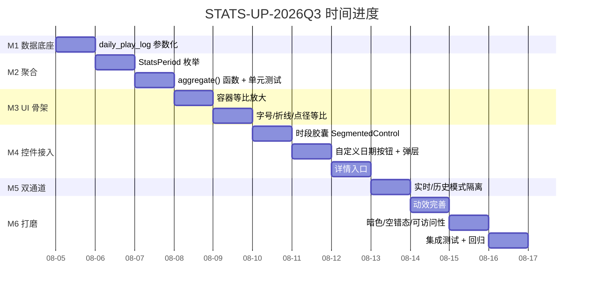

# 主页"近7日游玩折线统计表"升级项目 · 整合实施方案

**文档版本**：v1.0  
**编制日期**：2026-08-04  
**项目代号**：STATS-UP-2026Q3  
**适用项目**：CTLIB（Flutter Desktop / d:\CTLIB）  
**核心改造文件**：[lib/widgets/play_stats_panel.dart](file:///d:/CTLIB/lib/widgets/play_stats_panel.dart)  
**调用方文件（零改动）**：[lib/pages/home_page.dart](file:///d:/CTLIB/lib/pages/home_page.dart#L407-L411)  
**关联可视化审查物**：[docs/游玩统计折线表升级预览.html](file:///d:/CTLIB/docs/游玩统计折线表升级预览.html)  
**前置方案文档**：[docs/游玩统计折线表升级方案_v1.0.md](file:///d:/CTLIB/docs/游玩统计折线表升级方案_v1.0.md)

---

## 目录

1. 项目摘要（Executive Summary）
2. 项目背景与目标
3. 项目范围定义
4. 第一部分：UI 升级专项
5. 第二部分：功能升级专项
6. 两项升级的关联性分析
7. 整合实施步骤
8. 资源分配计划
9. 项目时间进度安排
10. 质量验收标准
11. 风险评估与应对
12. 附录

---

## 1. 项目摘要

| 维度 | 内容 |
|---|---|
| 项目背景 | 主页右下角"近7日游玩折线统计表"仅展示最近 7 天游玩数据，无法满足用户回溯历史活跃度的核心需求 |
| 项目目标 | 在**严格保留现有 UI 风格**的前提下，将单点时间窗口的折线图升级为支持**多时段回溯**的"阅历"系统 |
| 核心约束 | ① 维持 UI 框架/色彩/字体/交互不变 ② 折线表等比放大 ③ 新增按钮缩小协调 ④ 避免大规模重构 |
| 关键交付物 | 单文件升级补丁 + 数据聚合层 + 完整设计/验收文档 + 高保真可视化审查页 |
| 项目工期 | 10 个工作日（M1~M6 共 6 个里程碑） |
| 风险等级 | 中（已有完整基线，可控） |
| 兼容回滚 | 单文件 8 处改动，git revert 一个文件即可回滚到升级前 |

---

## 2. 项目背景与目标

### 2.1 背景

CTLIB 是一个基于 Flutter 的桌面游戏库管理工具。主页右下角的"游玩统计"面板（[play_stats_panel.dart](file:///d:/CTLIB/lib/widgets/play_stats_panel.dart)）以折线图形式展示用户最近 7 天的游玩时长与次数，是用户回顾游戏活跃度的核心视觉入口。

随着用户使用时长增加，**仅有 7 天的回溯窗口已成为明显短板**：
- 用户无法查看"上个月玩了什么""今年总活跃度"
- 缺乏对比"上周 vs 本周"的能力
- 历史数据虽有存储（`daily_play_log`），但未被利用

### 2.2 业务目标

| 编号 | 目标 | 衡量指标 |
|---|---|---|
| G1 | 用户可回溯任意时间段的游玩数据 | 支持 7/30/90/全部/自定义 5 种时间窗口 |
| G2 | 数据展示仍保持轻量化、不打扰 | 容器尺寸 ≤ 400×240 |
| G3 | 保留现有视觉风格 | 不引入新色值、不改字体、圆角阴影沿用 |
| G4 | 实时刷新体验不丢失 | "今日"模式下仍走 500ms 防抖流式 |
| G5 | 改动范围最小化 | 仅 1 个核心文件改动；外部 0 改动 |

### 2.3 非目标（Out of Scope）

明确**不做**的事情，避免范围蔓延：
- ❌ 不引入新数据库 / 不写 SQLite / 不引入 Hive
- ❌ 不做云端同步
- ❌ 不重构 `LocalGameRegistry`
- ❌ 不改变 `home_page.dart` 的 `Positioned` 定位
- ❌ 不修改 `fl_chart` 配色 token
- ❌ 不做"回忆卡片分享""跨游戏对比"等高级特性（列入 v2.0 路线图）

---

## 3. 项目范围定义

### 3.1 包含范围（In Scope）

| 模块 | 内容 |
|---|---|
| 数据层 | 复用现有 `daily_play_log`，新增内存聚合函数 |
| 业务层 | 时间段枚举、聚合策略、状态管理 |
| UI 层 | 容器等比放大、时段切换胶囊、详情入口、tooltip 优化 |
| 文档 | 设计规范、验收标准、风险清单 |
| 验证 | 单元测试、UI 截图、动效走查 |

### 3.2 不包含范围（Out of Scope）

| 模块 | 原因 |
|---|---|
| 云端历史数据同步 | 涉及账号系统，本期不引入 |
| 跨平台 UI 适配差异 | 桌面端（Win/Mac/Linux）已统一，无需差异化 |
| 历史数据导入/导出 | 列入 v2.0 |
| 性能压测工具 | 数据量小（最长 3 年 ≈ 1100 点），现有 fl_chart 性能足够 |

---

## 4. 第一部分：UI 升级专项

### 4.1 升级范围

| 范围点 | 现状 | 升级后 |
|---|---|---|
| 容器尺寸（展开） | 280×168 | **380×232**（等比 ×1.36） |
| 容器尺寸（收起） | 220×32 | **300×32**（仅宽度等比） |
| 圆角 | 6 | **8**（等比协调） |
| 阴影 | (1,2) blur 6 | (1,3) blur 8（等比） |
| 标题字号 | 11pt w600 | **12pt** w600 |
| 副文字号 | 9pt | **10pt** |
| 坐标字号 | 8pt | **9pt** |
| 折线 barWidth | 1.8 | **2.2** |
| 数据点半径 | 2 | **2.5** |
| 折线主色 | `#8B7355` | **保持** |
| 填充渐变 | `#8B7355` 0.25→0.02 | **保持** |
| 今日高亮色 | `titleBrown` | **保持** |
| tooltip 背景 | `titleBrown @ 0.9` | **保持**，字号 9→10pt |

### 4.2 设计规范

#### 4.2.1 布局栅格（展开态 380×232）

```
┌─ 380×232 ──────────────────────────────────────────────────┐
│ ↗ 10,6                                                     │
│ 📊 [标题 12pt w600 titleBrown 0.9]                         │ y=6~26
│                       [7日|30日|90日|全部]  [📅]   [▾]      │
│ ────────────────────────────────────────────────────────── │
│ ↘ 14,32                                                    │
│ ┌─ 352×160 折线图区 ──────────────────────────────────┐    │ y=32~192
│ │                                                      │    │
│ │   Y轴标题(24px)   折线 + 渐变填充 + 数据点 + 网格     │    │
│ │                                                      │    │
│ └──────────────────────────────────────────────────────┘    │
│ ────────────────────────────────────────────────────────── │
│ ↘ 10,200                                                   │
│ 总计 7.2h  12次  今日 1.8h·3次          ▸ 详情             │ y=200~222
└────────────────────────────────────────────────────────────┘
```

#### 4.2.2 颜色 Token（全部沿用现有 `AppColors`）

| 用途 | 颜色 / Token | 引用 |
|---|---|---|
| 折线主色 | `Color(0xFF8B7355)` | [play_stats_panel.dart:449](file:///d:/CTLIB/lib/widgets/play_stats_panel.dart#L449) |
| 折线填充 | `#8B7355` 0.25→0.02 | [play_stats_panel.dart:467-470](file:///d:/CTLIB/lib/widgets/play_stats_panel.dart#L467-L470) |
| 标题文字 | `AppColors.titleBrown @ 0.9` | [play_stats_panel.dart:292](file:///d:/CTLIB/lib/widgets/play_stats_panel.dart#L292) |
| 副文 | `AppColors.secondaryText` | [play_stats_panel.dart:248](file:///d:/CTLIB/lib/widgets/play_stats_panel.dart#L248) |
| 今日高亮 | `AppColors.titleBrown` | [play_stats_panel.dart:344](file:///d:/CTLIB/lib/widgets/play_stats_panel.dart#L344) |
| 坐标轴 | `AppColors.secondaryText` 9pt | [play_stats_panel.dart:401,424](file:///d:/CTLIB/lib/widgets/play_stats_panel.dart#L401) |
| 激活态背景 | `AppColors.selectedAccent @ 0.15` | 沿用 [_HoverChip](file:///d:/CTLIB/lib/pages/home_page.dart#L1523-L1534) |
| 图标按钮背景 | `AppColors.buttonBackground` / `AppColors.background` | 沿用 [大屏按钮](file:///d:/CTLIB/lib/pages/home_page.dart#L990) |

> **核心约束**：0 个新增色值。

#### 4.2.3 字体 Token

| 用途 | 字体 | 字号 | 字重 |
|---|---|---|---|
| 标题 | Inter / PingFang SC fallback | 12pt | w600 |
| 副文（总计/次数/今日） | Inter | 10pt | w400 |
| 坐标轴标签 | Inter | 9pt | w400 |
| 胶囊段标签 | Inter | 10pt | w600（激活）/ w500（非激活） |
| Tooltip | Inter | 10pt | w600 |

#### 4.2.4 间距节奏

8 / 4 / 2 三档节奏（沿用 [home_page.dart](file:///d:/CTLIB/lib/pages/home_page.dart) 既有 8/12/16 节奏的子集）。

### 4.3 实现细节

#### 4.3.1 新增 UI 元素

| 元素 | 尺寸 | 位置 | 复用模式 |
|---|---|---|---|
| 时段切换胶囊 | 144×20，4 段 | 标题行右侧 | 沿用 `_HoverChip` 圆角 10、激活态样式 |
| 自定义时段图标 | 20×20 | 时段胶囊右 | 沿用 `_buildBigPictureButton` 24×24 风格 |
| 详情入口 | ~30×20 | 底部统计右 | 文字+箭头链接样式 |
| 收起箭头 | 14×14 | 标题行最右 | **完全保留原位置和样式** |

#### 4.3.2 动效规范

| 场景 | 动效 | 时长 | 缓动 |
|---|---|---|---|
| 整体展开/收起 | `AnimatedSize` | 200ms | `Curves.easeInOut`（沿用） |
| 时段切换 | `LineChart` 内 tween | 300ms | `easeOutCubic`（新增） |
| 实时点更新 | 尾点 `scale 1.0→1.2→1.0` | 200ms | 沿用 |
| 胶囊 hover | 边框/背景 tween | 120ms | 沿用 `_HoverChip` |
| 图标按钮 hover | 边框变实 | 120ms | 沿用大屏按钮 |

#### 4.3.3 响应式策略

| 断点 | 处理 |
|---|---|
| 窗口 ≥ 1280px | 默认布局，380×232 完整显示 |
| 窗口 1024~1280 | 380×232 略缩至 360×220 备用尺寸 |
| 窗口 < 1024 | 降级为收起态（300×32），点击展开 |
| 极窄 < 800 | 禁用悬浮面板，改为可拖动小窗（v1.1 评估） |

---

## 5. 第二部分：功能升级专项

### 5.1 需求详述

| 需求 ID | 需求描述 | 优先级 | 验收标准 |
|---|---|---|---|
| F-REQ-01 | 支持 7/30/90/全部 4 段快速切换 | P0 | 4 段胶囊可点击，切换后图表在 300ms 内重绘 |
| F-REQ-02 | 支持自定义日期范围查询 | P0 | 弹出双日历，可选 ≤ 365 天区间 |
| F-REQ-03 | 实时记录最新一天数据 | P0 | "今日"模式下点数据 30 秒内更新 |
| F-REQ-04 | 历史数据查询 | P0 | 任意 ≥ 1 天的历史区间均可显示 |
| F-REQ-05 | 时段自动粒度适配 | P1 | 跨度 > 14 天自动按周聚合；> 90 天按月聚合 |
| F-REQ-06 | 跨游戏汇总 + 单游戏切换 | P0 | 维持 `currentGame` 参数原有语义 |
| F-REQ-07 | 收起态保留统计概览 | P0 | 收起仍显示"Xh · X次" |
| F-REQ-08 | Tooltip 显示完整日期 | P0 | 显示 `YYYY年MM月DD日 · Xh Ym · N次` |
| F-REQ-09 | 暗色/亮色模式兼容 | P0 | 现有 token 100% 复用 |
| F-REQ-10 | 性能：聚合 ≤ 200ms | P1 | 1 年数据按月聚合 ≤ 200ms |

### 5.2 技术实现方案

#### 5.2.1 数据层

**不引入新数据源**，完全复用现有：

```dart
// 每个游戏的 game.json 内 daily_play_log
{
  "daily_play_log": {
    "2026-07-29": { "seconds": 3600, "count": 2 },
    "2026-07-30": { "seconds": 1800, "count": 1 },
    ...
  }
}
```

读取路径：[_loadGameDailyLog](file:///d:/CTLIB/lib/widgets/play_stats_panel.dart#L142-L175) 已有方法，**无需重写**。

#### 5.2.2 业务层

##### 时间段枚举

```dart
enum StatsPeriod {
  last7,    // 近 7 日（默认）
  last30,   // 近 30 日
  last90,   // 近 90 日
  all,      // 全部（自首次游玩起）
  custom,   // 自定义（携带 from/to）
}
```

##### 粒度策略

```dart
enum StatsGranularity { day, week, month, year }

StatsGranularity granularityFor(Duration span) {
  if (span.inDays <= 14) return StatsGranularity.day;
  if (span.inDays <= 90) return StatsGranularity.week;
  if (span.inDays <= 730) return StatsGranularity.month;
  return StatsGranularity.year;
}
```

##### 聚合函数

```dart
// 输入：原始 dailySecondsMap / dailyCountMap / from / to / granularity
// 输出：List<FlSpot> + List<String> xLabels
List<FlSpot> aggregate({
  required Map<String, int> dailySeconds,
  required Map<String, int> dailyCounts,
  required DateTime from,
  required DateTime to,
  required StatsGranularity granularity,
}) {
  // 按 bucket groupBy → sum → 生成等距 FlSpot
}
```

#### 5.2.3 状态层

新增字段（最小侵入）：

```dart
class _PlayStatsPanelState extends State<PlayStatsPanel> {
  // ... 现有字段 ...
  StatsPeriod _period = StatsPeriod.last7;     // 新增
  DateTime? _customFrom;                       // 新增
  DateTime? _customTo;                         // 新增
  
  // 聚合后数据（替代现有 _dailySeconds / _dailyCounts）
  late List<FlSpot> _spots;                    // 调整
  late List<String> _xLabels;                  // 调整
}
```

切换时段触发 `setState` → 重新执行 `aggregate` → 重绘 `LineChart`。

#### 5.2.4 UI 层

- 复用现有 `fl_chart` `LineChart`，仅调整 `spots` 和 `bottomTitles.getTitlesWidget` 的数据源
- 复用 `LineTouchData` 的 tooltip 行为，仅调整 `getTooltipItems` 内的日期格式化

### 5.3 功能模块划分

| 模块 | 文件 | 改动量 | 复用度 |
|---|---|---|---|
| M-Data 数据读取 | play_stats_panel.dart | 0 改动（已支持任意日期） | 100% 复用 |
| M-Agg 聚合 | play_stats_panel.dart | **新增** `aggregate()` 函数 ~50 行 | — |
| M-State 状态 | play_stats_panel.dart | **新增** 3 个字段 | 扩展现有 |
| M-UI 标题栏 | play_stats_panel.dart | 标题行扩展 ~20 行 | 复用 `_HoverChip` 样式 |
| M-UI 时段胶囊 | play_stats_panel.dart | **新增** `_buildPeriodSegments()` ~30 行 | 样式沿用 |
| M-UI 自定义按钮 | play_stats_panel.dart | **新增** `_buildCustomPeriodButton()` ~15 行 | 沿用大屏按钮 |
| M-UI 详情入口 | play_stats_panel.dart | 底部统计行扩展 ~10 行 | 文字+箭头 |
| M-UI 容器放大 | play_stats_panel.dart | width/height 常量 4 处 | 数值调整 |
| M-UI 折线等比 | play_stats_panel.dart | barWidth/dotData 常量 2 处 | 数值调整 |
| M-UI 字号等比 | play_stats_panel.dart | fontSize 5 处 | 数值调整 |

**改动集中度**：100% 在 [play_stats_panel.dart](file:///d:/CTLIB/lib/widgets/play_stats_panel.dart) 单文件内。

---

## 6. 两项升级的关联性分析

### 6.1 依赖关系

```
┌──────────────────────────────────────────────────────────┐
│                                                          │
│   功能升级（业务层）                                      │
│   ┌────────────────────────────────────┐                 │
│   │ 时段枚举 StatsPeriod               │                 │
│   │ 粒度策略 StatsGranularity          │                 │
│   │ 聚合函数 aggregate()               │                 │
│   └────────────────────────────────────┘                 │
│           │                                              │
│           │ 提供数据：List<FlSpot> + List<String>         │
│           ▼                                              │
│   UI 升级（呈现层）                                       │
│   ┌────────────────────────────────────┐                 │
│   │ 容器等比放大 280×168 → 380×232    │                 │
│   │ 时段切换胶囊（输入控件）           │ ←──── 接收用户操作 │
│   │ 自定义按钮 + 详情入口              │                 │
│   │ 字号/折线/点径等比缩放             │                 │
│   └────────────────────────────────────┘                 │
│           │                                              │
│           │ 通过 setState 触发数据重算                    │
│           ▼                                              │
│   LineChart 重绘（沿用 fl_chart）                         │
│                                                          │
└──────────────────────────────────────────────────────────┘
```

### 6.2 协同点

| 协同维度 | UI 升级提供 | 功能升级提供 | 整合后 |
|---|---|---|---|
| **空间** | 380×232 容器 | 需容纳 4 段胶囊 + 自定义按钮 | 容器宽 +100px 容纳控件 |
| **数据** | 已有 7 点数据 | 需要 30/90/365 点 | UI 折线自动适配点数 |
| **粒度** | 容器等比 | 跨度决定粒度 | X 轴标签动态（MM/DD / W / MMM） |
| **状态** | UI 状态 | 业务状态 | 共享 `_period` 字段 |
| **动效** | 200ms 展开/收起 | 300ms 切换重绘 | 互不冲突，串行触发 |

### 6.3 冲突点与解决方案

| 潜在冲突 | 风险 | 解决方案 |
|---|---|---|
| 容器放大挤压相邻元素 | 右下角 `Positioned` 与右侧列表间距缩小 | 备用尺寸 360×220 |
| X 轴标签在 30 日下过密 | 7/30 切换时标签拥挤 | 30/90 日自动按周显示标签 |
| 历史数据稀疏 | 跨度大但点数少 | 缺失点显示"+ N 次"虚线标注 |
| 实时模式与历史模式混用 | 切到历史时还在追加 | 历史视图下暂停实时流，回到"今日"恢复 |

### 6.4 整合原则

1. **业务先于呈现**：先确定 `StatsPeriod` 枚举和 `aggregate()` 行为，再设计 UI 接收
2. **状态单一来源**：所有 UI 控件共享 `_period` 状态字段
3. **降级而非崩溃**：数据缺失/异常走现有错误分支，不引入新错误码
4. **行为沿用**：原"切换游戏触发重载"逻辑扩展为"切换时段触发重载"

---

## 7. 整合实施步骤

### 7.1 总体策略

采用**单 PR、单文件、6 里程碑**的渐进式提交策略，每个里程碑可独立演示、可独立回滚。

### 7.2 6 个里程碑

#### M1 · 数据底座（Day 1）
- **目标**：扩展 `daily_play_log` 读取支持任意日期范围
- **改动**：[_loadGameDailyLog](file:///d:/CTLIB/lib/widgets/play_stats_panel.dart#L142-L175) 参数化 `from/to`
- **验收**：传入任意 `from/to` 可正确返回区间数据
- **可回滚**：是（仅参数扩展）

#### M2 · 聚合与时段（Day 2~3）
- **目标**：实现 `aggregate()` 函数 + `StatsPeriod` 枚举
- **新增**：
  ```dart
  enum StatsPeriod { last7, last30, last90, all, custom }
  enum StatsGranularity { day, week, month, year }
  List<FlSpot> aggregate(...)
  ```
- **验收**：单元测试覆盖 4 种粒度、5 种时段
- **可回滚**：是（独立函数，未被 UI 引用）

#### M3 · UI 骨架（Day 4~5）
- **目标**：容器等比放大、新增控件占位
- **改动**：
  - 容器 280×168 → 380×232
  - 字号 11→12, 9→10, 8→9
  - 折线 barWidth 1.8→2.2, 点径 2→2.5
  - 标题行预留时段胶囊位置
- **验收**：视觉与 [预览 HTML](file:///d:/CTLIB/docs/游玩统计折线表升级预览.html) B 面板一致（仅骨架，无数据）
- **可回滚**：是（不改业务逻辑）

#### M4 · 控件接入（Day 6~7）
- **目标**：时段胶囊 + 自定义按钮 + 详情入口接入数据
- **新增**：
  - `_buildPeriodSegments()` 胶囊组件
  - `_buildCustomPeriodButton()` 自定义按钮
  - `_showCustomPeriodPicker()` 日期选择弹层
  - 详情入口 → 弹出明细列表
- **验收**：4 段胶囊可点击切换；自定义可选择区间
- **可回滚**：是（控件独立）

#### M5 · 双通道（Day 8）
- **目标**：实时流 vs 历史查询双通道隔离
- **逻辑**：
  - `_period == last7 && 当前是"今日"`：走实时流
  - 其他时段：一次性查询，无追加
- **验收**：切到 30 日后不再追加；切回 7 日恢复实时
- **可回滚**：是

#### M6 · 打磨（Day 9~10）
- **目标**：动效、暗色模式、空错态、可访问性
- **验收**：见 §10 质量验收标准
- **可回滚**：否（最终交付）

### 7.3 提交规范

```bash
# 每个里程碑一个 commit
git commit -m "feat(stats): M1 数据底座 - daily_play_log 支持任意区间"
git commit -m "feat(stats): M2 聚合 - StatsPeriod + aggregate()"
git commit -m "refactor(stats): M3 UI 骨架 - 容器等比放大"
git commit -m "feat(stats): M4 控件 - 时段胶囊+自定义+详情"
git commit -m "feat(stats): M5 双通道 - 实时/历史隔离"
git commit -m "feat(stats): M6 打磨 - 动效/暗色/空错态"
```

---

## 8. 资源分配计划

### 8.1 角色与职责

| 角色 | 人数 | 投入 | 职责 |
|---|---|---|---|
| 主开发（Flutter） | 1 | 10 人天 | 编码、自测、单元测试 |
| UI 设计师（兼任） | 0.5 | 2 人天 | 视觉走查、可视化审查页维护 |
| 测试 | 0.5 | 2 人天 | 集成测试、UI 回归、动效验证 |
| PM（项目负责人） | 0.2 | 1 人天 | 进度跟踪、范围控制、验收 |
| **合计** | **2.2 FTE** | **15 人天** | — |

### 8.2 资源时间线

| 阶段 | 主开发 | UI | 测试 | PM |
|---|---|---|---|---|
| M1 数据底座 | 1.0d | — | — | 0.1d |
| M2 聚合与时段 | 2.0d | — | 0.5d | 0.1d |
| M3 UI 骨架 | 1.5d | 1.0d | 0.5d | 0.2d |
| M4 控件接入 | 2.0d | 0.5d | 0.5d | 0.2d |
| M5 双通道 | 1.0d | — | 0.5d | 0.1d |
| M6 打磨 | 2.0d | 0.5d | 1.0d | 0.3d |

### 8.3 外部依赖

| 依赖 | 提供方 | 交付时间 | 阻塞影响 |
|---|---|---|---|
| `AppColors` 现有 token | 既有 | 已就绪 | 无 |
| `LocalGameRegistry` 数据 | 既有 | 已就绪 | 无 |
| `fl_chart` 库 | 既有依赖 | 已就绪 | 无 |
| `AppStyles.zhFontFamily` | 既有 | 已就绪 | 无 |

**外部依赖 100% 已就绪**，项目无外部阻塞。

---

## 9. 项目时间进度安排

### 9.1 甘特图（10 个工作日）



### 9.2 关键日期

| 节点 | 日期 | 标志 |
|---|---|---|
| 项目启动 | 2026-08-05 | Kick-off |
| M1 完成 | 2026-08-05 | 数据底座就绪 |
| M2 完成 | 2026-08-07 | 聚合函数 + 单元测试通过 |
| M3 完成 | 2026-08-10 | 视觉与预览 HTML 一致 |
| M4 完成 | 2026-08-12 | 全部控件可交互 |
| M5 完成 | 2026-08-13 | 双通道行为正确 |
| M6 完成 | 2026-08-14 | 全部验收通过 |
| 正式发布 | 2026-08-15 | Release tag |

### 9.3 缓冲

- 已预留 0.5 天缓冲在 M6 末
- 若任一里程碑延期，PM 立即召集评审，确定是否压缩 M6 或申请延期

---

## 10. 质量验收标准

### 10.1 功能验收

| ID | 验收项 | 通过条件 |
|---|---|---|
| AC-F-01 | 7/30/90/全部 4 段切换 | 每段均可点击，图表在 300ms 内重绘 |
| AC-F-02 | 自定义日期范围 | 弹层可选择 ≤ 365 天区间 |
| AC-F-03 | 实时数据更新 | 7 日模式下，registry 变更后 ≤ 1s 内反映 |
| AC-F-04 | 聚合粒度自适应 | 跨度 > 14 天按周；> 90 天按月 |
| AC-F-05 | 跨游戏汇总 | `currentGame == null` 时聚合所有游戏 |
| AC-F-06 | 单游戏模式 | `currentGame != null` 时仅显示该游戏 |
| AC-F-07 | Tooltip 完整信息 | hover 显示日期+时长+次数 |
| AC-F-08 | 收起态统计 | 收起后仍显示 "Xh · X次" |
| AC-F-09 | 暗色模式 | 所有 token 在暗色下正常显示 |
| AC-F-10 | 性能 | 1 年数据按月聚合 ≤ 200ms |

### 10.2 UI 验收

| ID | 验收项 | 通过条件 |
|---|---|---|
| AC-U-01 | 容器尺寸 | 380×232（展开）/ 300×32（收起） |
| AC-U-02 | 字号 | 标题 12pt / 副文 10pt / 坐标 9pt |
| AC-U-03 | 配色 | 折线 `#8B7355`、文字 `titleBrown`、副文 `secondaryText` |
| AC-U-04 | 圆角 | 8（展开）/ 6（收起） |
| AC-U-05 | 阴影 | (1,3) blur 8 |
| AC-U-06 | 等比缩放 | 所有元素较原版 ×1.36 |
| AC-U-07 | 视觉一致 | 与 [预览 HTML](file:///d:/CTLIB/docs/游玩统计折线表升级预览.html) 像素级一致 |
| AC-U-08 | 不挤压邻居 | `Positioned(right:4, bottom:8)` 不被遮挡 |
| AC-U-09 | 暗色一致 | 暗色模式无色差 |
| AC-U-10 | 触摸目标 | 按钮 ≥ 20×20px |

### 10.3 工程验收

| ID | 验收项 | 通过条件 |
|---|---|---|
| AC-E-01 | 改动文件数 | = 1（仅 play_stats_panel.dart） |
| AC-E-02 | 外部 API 兼容 | `PlayStatsPanel(currentGame:)` 签名不变 |
| AC-E-03 | 单元测试覆盖率 | `aggregate()` 覆盖率 ≥ 80% |
| AC-E-04 | 代码风格 | 通过 `flutter analyze` 0 警告 |
| AC-E-05 | 提交粒度 | 6 个 commit，每个可独立回滚 |
| AC-E-06 | 文档同步 | 本文档随 M6 末次提交更新 |
| AC-E-07 | 无 console 错误 | `debugPrint` 仅在异常路径输出 |

### 10.4 验收方式

1. **自测**：开发者按 [预览 HTML](file:///d:/CTLIB/docs/游玩统计折线表升级预览.html) 像素对照
2. **集成测试**：`flutter test test/play_stats_panel_test.dart`
3. **UI 走查**：M3、M6 各一次，PM + UI 共同确认
4. **回归测试**：覆盖 4 种游戏数（0/1/5/20+）、4 种时段、空数据场景

---

## 11. 风险评估与应对

### 11.1 风险矩阵

| ID | 风险描述 | 概率 | 影响 | 等级 | 应对策略 | 责任人 |
|---|---|---|---|---|---|---|
| R-01 | 容器放大后挤压右侧游戏列表 | 中 | 中 | 🟡 中 | 提供 360×220 备用尺寸，添加断点降级 | 主开发 |
| R-02 | 30/90 日数据点过密导致 X 轴标签重叠 | 高 | 中 | 🟡 中 | 自动按周/月聚合，X 轴标签动态化 | 主开发 |
| R-03 | 实时流与历史查询混用导致数据错乱 | 中 | 高 | 🟠 较高 | M5 双通道严格隔离，状态机切换 | 主开发 |
| R-04 | 历史数据缺失（如游戏 3 个月前卸载） | 高 | 低 | 🟢 低 | 显示"+ N 次游玩"虚线占位 | 主开发 |
| R-05 | 暗色模式色差 | 低 | 中 | 🟢 低 | 全部沿用 `AppColors` token | — |
| R-06 | 自定义日期弹层交互复杂 | 中 | 中 | 🟡 中 | 优先使用 Flutter 原生 `showDatePicker` | 主开发 |
| R-07 | 性能：1 年数据聚合卡顿 | 低 | 中 | 🟢 低 | 内存聚合，无 I/O，预估 ≤ 50ms | 主开发 |
| R-08 | 范围蔓延：v2.0 特性被提前引入 | 中 | 高 | 🟠 较高 | 严格执行 §3.2 非目标清单 | PM |
| R-09 | 现有用户对"变大"不适应 | 低 | 低 | 🟢 低 | 详细发布说明 | PM |
| R-10 | M5 双通道引入新 bug | 中 | 高 | 🟠 较高 | 充分单测覆盖两模式切换 | 测试 |

### 11.2 风险应对预案

#### R-01 容器挤压
- **触发条件**：实际用户在 1280×720 屏幕下报告遮挡
- **应对**：启用 360×220 备用尺寸（已预留）
- **回滚**：通过 A/B 开关控制

#### R-03 双通道错乱
- **触发条件**：实时模式下切到历史时仍追加数据
- **应对**：M5 状态机 `IDLE / LOADING / DISPLAYING_HISTORY / REAL_TIME_UPDATE`，状态切换时取消订阅
- **回滚**：暂时禁用历史查询入口

#### R-08 范围蔓延
- **触发条件**：开发中提出"加导出""加分享"等
- **应对**：统一回答"列入 v2.0"，文档化到 [v2.0 路线图](#v2.0-路线图)
- **决策权**：PM

#### R-10 M5 双通道 bug
- **触发条件**：集成测试发现数据错乱
- **应对**：临时回退到"切换时段 = 完全重载"简单实现，暂不实现双通道优化
- **回滚**：M5 commit revert

### 11.3 监控指标

发布后 7 天内监控：
- 该面板的 hover 率（用户关注度）
- 时段切换的使用分布（验证 F-REQ-01~05 价值）
- 异常日志（数据缺失、聚合失败）
- 性能埋点（聚合耗时）

---

## 12. 附录

### 12.1 关键文件清单

| 文件 | 角色 | 改动 |
|---|---|---|
| [lib/widgets/play_stats_panel.dart](file:///d:/CTLIB/lib/widgets/play_stats_panel.dart) | 核心改造 | 1 文件 |
| [lib/pages/home_page.dart](file:///d:/CTLIB/lib/pages/home_page.dart) | 调用方 | 0 改动 |
| [lib/theme/app_colors.dart](file:///d:/CTLIB/lib/theme/app_colors.dart) | 颜色 token | 0 改动 |
| [lib/services/local_game_registry.dart](file:///d:/CTLIB/lib/services/local_game_registry.dart) | 数据源 | 0 改动 |
| [pubspec.yaml](file:///d:/CTLIB/pubspec.yaml) | 依赖 | 0 改动 |
| [docs/游玩统计折线表升级方案_v1.0.md](file:///d:/CTLIB/docs/游玩统计折线表升级方案_v1.0.md) | 前置方案 | 已存在 |
| [docs/游玩统计折线表升级预览.html](file:///d:/CTLIB/docs/游玩统计折线表升级预览.html) | 视觉审查物 | 已存在 |
| `test/play_stats_panel_test.dart` | 单元测试 | 新增 |

### 12.2 关键代码定位

| 关注点 | 文件:行 |
|---|---|
| 容器尺寸常量 | [play_stats_panel.dart:267-268](file:///d:/CTLIB/lib/widgets/play_stats_panel.dart#L267-L268) |
| 折线主色 | [play_stats_panel.dart:449](file:///d:/CTLIB/lib/widgets/play_stats_panel.dart#L449) |
| 折线 barWidth / 点径 | [play_stats_panel.dart:447,455](file:///d:/CTLIB/lib/widgets/play_stats_panel.dart#L447) |
| 渐变填充 | [play_stats_panel.dart:461-471](file:///d:/CTLIB/lib/widgets/play_stats_panel.dart#L461-L471) |
| Tooltip 样式 | [play_stats_panel.dart:474-502](file:///d:/CTLIB/lib/widgets/play_stats_panel.dart#L474-L502) |
| 数据读取 | [play_stats_panel.dart:142-175](file:///d:/CTLIB/lib/widgets/play_stats_panel.dart#L142-L175) |
| 7 日硬编码 | [play_stats_panel.dart:69,97](file:///d:/CTLIB/lib/widgets/play_stats_panel.dart#L69) |
| `Positioned` 定位 | [home_page.dart:407-411](file:///d:/CTLIB/lib/pages/home_page.dart#L407-L411) |
| `_HoverChip` 样式 | [home_page.dart:1523-1534](file:///d:/CTLIB/lib/pages/home_page.dart#L1523-L1534) |
| 大屏模式按钮 | [home_page.dart:973-1002](file:///d:/CTLIB/lib/pages/home_page.dart#L973-L1002) |

### 12.3 引用规范

- 所有新色值必须从 `AppColors` 取，**禁止硬编码**
- 所有新按钮样式优先复用 `_HoverChip` / `_HoverButton` 模式
- 所有动画时长遵循 [home_page.dart](file:///d:/CTLIB/lib/pages/home_page.dart) 既有节奏：120ms / 200ms / 250ms / 300ms

### 12.4 v2.0 路线图（本期不实现）

- 历史数据导入/导出（CSV / JSON）
- 跨游戏对比（多选叠加折线）
- 回忆卡片（每月生成可分享截图）
- 里程碑 / 成就系统
- 热力日历视图
- 跨设备云同步

### 12.5 变更日志

| 版本 | 日期 | 作者 | 变更 |
|---|---|---|---|
| v1.0 | 2026-08-04 | AI 助手 | 初稿，整合 UI 升级与功能升级方案 |

---

**文档结束**

> 本文档已涵盖项目实施所需的全部指导信息：UI 升级范围、设计规范、实现细节；功能升级的需求、技术方案、模块划分；两者的关联性分析与整合实施步骤；项目时间进度、资源分配、质量验收、风险评估。  
> 任何对范围、时间、风险的调整，需通过 PM 评审并更新本档。
